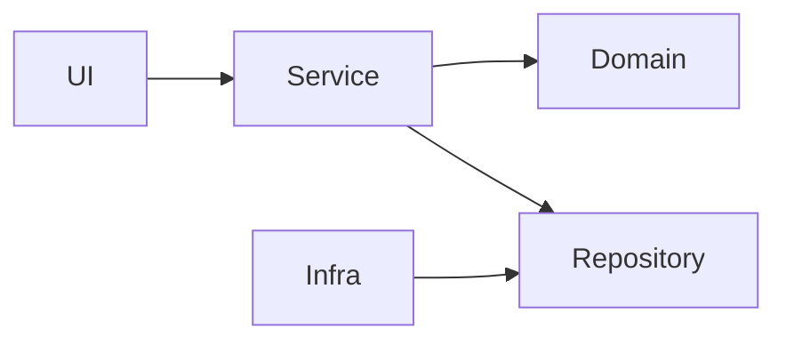

# Online Course Marketplace

> Capstone project — Application Design Based on Patterns (Design Patterns), 4th year, Information Systems.

**Team:** Forogh Anoosh (@ahmadforoghanoosh-alt), Shabir Mohibi (@Shabirsarabi)

**Roles (M1):** Forogh Anoosh: Maintainer · Shabir Mohibi: Architect

**Domain:** Instructors publish online courses, and students browse them, put them in a cart, pay with Kaspi or a bank card, get enrolled and receive a certificate when they finish.

Requirements: [docs/user-stories.md](docs/user-stories.md)

## Quick start
```bash
mvn verify                      # build + tests + coverage gate
mvn exec:java -Dexec.mainClass=kz.kaznaru.capstone.App   # or press F5 in VS Code
```

## Architecture
<!-- Insert a Mermaid class/component diagram here. -->


## Patterns used
See [docs/PATTERN_REGISTER.md](docs/PATTERN_REGISTER.md). Decisions: [docs/adr](docs/adr).

## Team workflow
Branch per issue, pull request per branch, one teammate review before merge.
