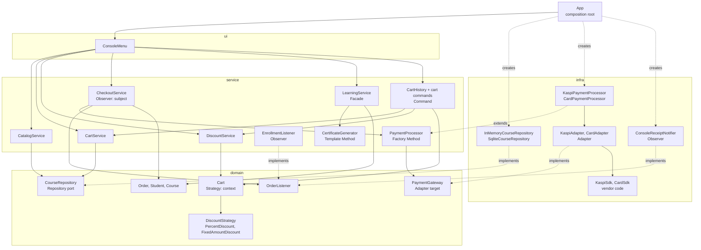

# Online Course Marketplace

> Capstone project — Application Design Based on Patterns (Design Patterns), 4th year, Information Systems.

**Team:** Forogh Anoosh (@ahmadforoghanoosh-alt), Shabir Mohibi (@Shabirsarabi)

**Roles (M1):** Forogh Anoosh: Maintainer · Shabir Mohibi: Architect

**Domain:** Instructors publish online courses, and students browse them, put them in a cart, pay with Kaspi or a bank card, get enrolled and receive a certificate when they finish.

Requirements: [docs/user-stories.md](docs/user-stories.md)

## Quick start
```bash
mvn verify                      # build + tests + coverage gate
mvn exec:java -Dexec.mainClass=kz.kaznaru.capstone.App   # or press F5 in VS Code
mvn exec:java -Dexec.mainClass=kz.kaznaru.capstone.App -Dexec.args="--memory"   # without the database
```

## Database
Courses are saved in a SQLite database file, `marketplace.db`, created in the project folder on the first run
(SQLite through JDBC, `SqliteCourseRepository`). Start with `--memory` to use the in-memory repository instead.
The services do not change: both classes implement `CourseRepository` ([ADR-0004](docs/adr/0004-sqlite-course-repository.md)).

| Table `courses` | Type |
|---|---|
| id | INTEGER PRIMARY KEY AUTOINCREMENT |
| title | TEXT NOT NULL |
| instructor | TEXT NOT NULL |
| description | TEXT NOT NULL |
| price | REAL NOT NULL, CHECK (price > 0) |

## Architecture
Four layers ([ADR-0001](docs/adr/0001-layers-and-package-rules.md)). Arrows show "uses". The rules are checked by
`ArchitectureTest`: `domain` uses nothing else, `service` does not use `infra` or `ui`, `ui` does not use `infra`.
Only `App` (the composition root) creates the concrete `infra` classes and wires everything together.



| Pattern | Category | Where | Register row |
|---------|----------|-------|--------------|
| Factory Method | Creational | `PaymentProcessor` → `KaspiPaymentProcessor`, `CardPaymentProcessor` | 1 |
| Adapter | Structural | `KaspiAdapter`, `CardAdapter` → `PaymentGateway` | 2 |
| Observer | Behavioral | `CheckoutService` → `EnrollmentListener`, `ConsoleReceiptNotifier` | 3 |
| Template Method | Behavioral | `CertificateGenerator` → `TextCertificateGenerator`, `HtmlCertificateGenerator` | 4 |
| Strategy | Behavioral | `Cart` + `DiscountStrategy` → `PercentDiscount`, `FixedAmountDiscount` | 5 |
| Repository | Architectural | `CourseRepository` → `InMemoryCourseRepository`, `SqliteCourseRepository` | 6 |
| Facade | Structural | `LearningService` over `Student` and the certificate generators | 7 |
| Command | Behavioral | `CartHistory` runs and undoes `AddToCartCommand`, `RemoveFromCartCommand`, `ApplyDiscountCommand` | 8 |

## Patterns used
See [docs/PATTERN_REGISTER.md](docs/PATTERN_REGISTER.md). Decisions: [docs/adr](docs/adr).

## Team workflow
Branch per issue, pull request per branch, one teammate review before merge.
