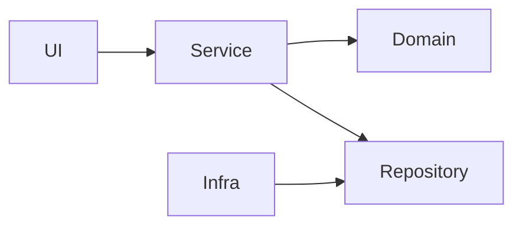

# <PROJECT NAME>

> Capstone project — Application Design Based on Patterns (Design Patterns), 4th year, Information Systems.

**Team:** <names and GitHub handles>
**Domain:** <one sentence: who uses the system and for what>

## Quick start
```bash
mvn verify                      # build + tests + coverage gate
mvn exec:java -Dexec.mainClass=kz.kaznaru.capstone.App   # or press F5 in VS Code
```

## Architecture
<!-- Insert a Mermaid class/component diagram here. -->


## Patterns used
See [docs/PATTERN_REGISTER.md](docs/PATTERN_REGISTER.md). Decisions: [docs/adr](docs/adr).

## Team workflow
Branch per issue, pull request per branch, one teammate review before merge.
