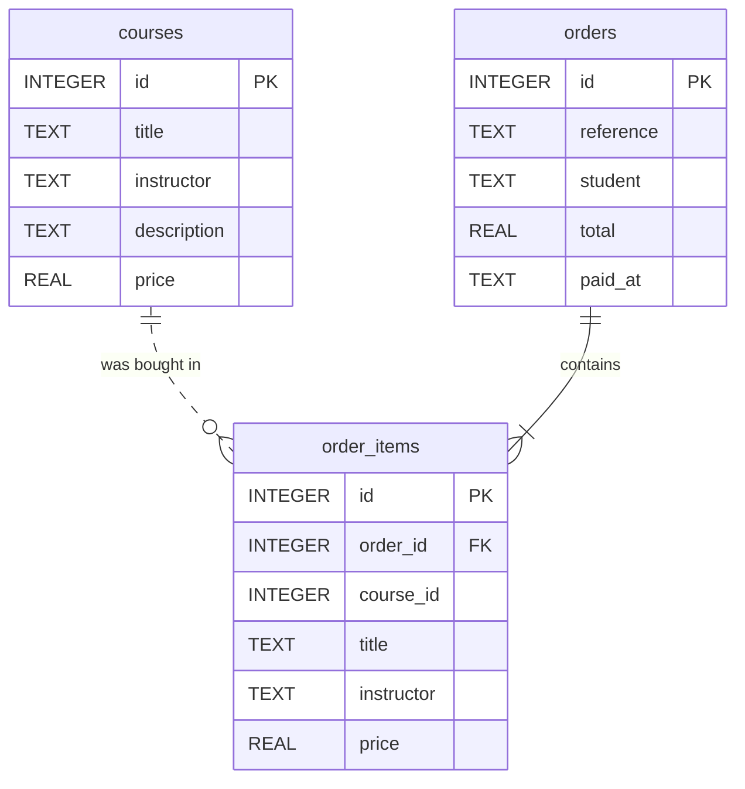
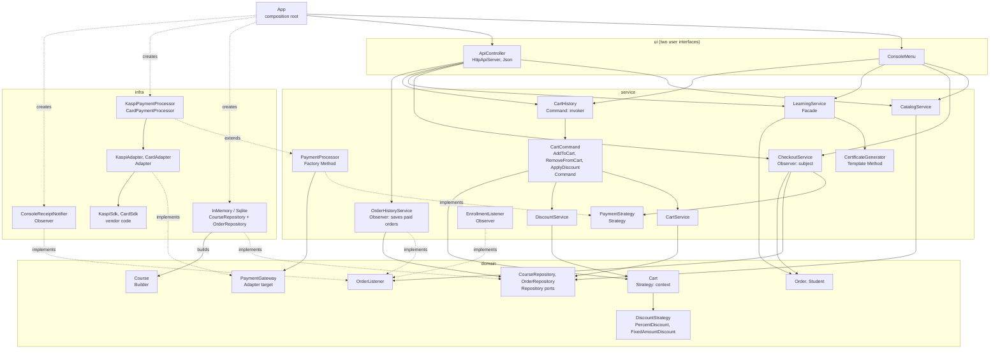

# Online Course Marketplace

> Capstone project — Application Design Based on Patterns (Design Patterns), 4th year, Information Systems.

**Team:** Forogh Anoosh (@ahmadforoghanoosh-alt), Shabir Mohibi (@Shabirsarabi)

**Roles (M1):** Forogh Anoosh: Maintainer · Shabir Mohibi: Architect

**Domain:** Instructors publish online courses, and students browse them, put them in a cart, pay with Kaspi or a bank card, get enrolled and receive a certificate when they finish.

Requirements: [docs/user-stories.md](docs/user-stories.md)

## Quick start
```bash
mvn verify                      # build + tests + coverage gate
mvn exec:java -Dexec.mainClass=kz.kaznaru.capstone.App   # or press F5 in VS Code
mvn exec:java -Dexec.mainClass=kz.kaznaru.capstone.App -Dexec.args="--memory"   # without the database
```

## REST API (second UI)
Start the same application as an HTTP API instead of the console menu ([ADR-0009](docs/adr/0009-http-api-as-second-ui.md)):
```bash
mvn exec:java -Dexec.mainClass=kz.kaznaru.capstone.App -Dexec.args="--api"   # http://localhost:8080
```
In VS Code: open Run and Debug, choose **Run API (port 8080)** and press F5.

| Method | Path | What it does |
|---|---|---|
| GET | `/courses` | all courses |
| GET | `/courses/{id}` | one course (404 if not found) |
| POST | `/courses?title=..&instructor=..&description=..&price=..` | add a course (201) |
| PUT | `/courses/{id}?title=..&instructor=..&description=..&price=..` | change a course (404 if not found) |
| DELETE | `/courses/{id}` | delete a course (404 if not found) |
| GET | `/cart` | cart with subtotal, discount and total |
| POST | `/cart/{id}` | add a course to the cart |
| DELETE | `/cart/{id}` | remove a course from the cart |
| POST | `/cart/discount?code=STUDENT10` | apply a discount code |
| POST | `/cart/undo` | undo the last cart change (Command) |
| GET | `/payment-methods` | Kaspi, Bank card (Strategy) |
| POST | `/checkout?method=Kaspi` | pay; the receipt is printed in the server console (Observer) |
| GET | `/orders` | order history from the database (reference, total, courses) |
| GET | `/my-courses` | the student's courses |
| POST | `/my-courses/{id}/certificate?format=Text` | complete a course and get a certificate (Facade + Template Method) |

Example: `curl -X POST "http://localhost:8080/cart/1"`

## Database
Courses and paid orders are saved in a SQLite database file, `marketplace.db`, created in the project folder on the
first run (SQLite through JDBC, `SqliteCourseRepository` and `SqliteOrderRepository`). Start with `--memory` to keep
everything in memory instead. The services do not change: they only know the `CourseRepository` and `OrderRepository`
interfaces ([ADR-0004](docs/adr/0004-sqlite-course-repository.md), [ADR-0010](docs/adr/0010-save-orders-in-the-database.md)).
A paid order is saved by an Observer (`OrderHistoryService`), so after a restart the order history and "My courses" are still there.
"NOT NULL" means the column must always have a value: the database refuses a row without it.



| Table `courses` | Type |
|---|---|
| id | INTEGER PRIMARY KEY AUTOINCREMENT |
| title | TEXT NOT NULL |
| instructor | TEXT NOT NULL |
| description | TEXT NOT NULL |
| price | REAL NOT NULL, CHECK (price > 0) |

| Table `orders` | Type |
|---|---|
| id | INTEGER PRIMARY KEY AUTOINCREMENT |
| reference | TEXT NOT NULL UNIQUE (ORD-1, ORD-2, ...) |
| student | TEXT NOT NULL |
| total | REAL NOT NULL, CHECK (total >= 0) |
| paid_at | TEXT NOT NULL, date and time of the payment |

| Table `order_items` | Type |
|---|---|
| id | INTEGER PRIMARY KEY AUTOINCREMENT |
| order_id | INTEGER NOT NULL, REFERENCES orders(id) |
| course_id | INTEGER NOT NULL |
| title, instructor | TEXT NOT NULL, copied on the day of the purchase |
| price | REAL NOT NULL, the price that was paid |

`order_items` keeps a copy of the title and price, like a real receipt: if a course is changed or deleted later, old orders stay correct.

## Architecture
Four layers ([ADR-0001](docs/adr/0001-layers-and-package-rules.md)). Arrows show "uses". The rules are checked by
`ArchitectureTest`: `domain` uses nothing else, `service` does not use `infra` or `ui`, `ui` does not use `infra`.
Only `App` (the composition root) creates the concrete `infra` classes and wires everything together.
There are two user interfaces, `ConsoleMenu` and the REST API (`ApiController`). Both use the same services,
so no business rule is written twice.



| Pattern | Category | Where | Register row |
|---------|----------|-------|--------------|
| Factory Method | Creational | `PaymentProcessor` → `KaspiPaymentProcessor`, `CardPaymentProcessor` | 1 |
| Adapter | Structural | `KaspiAdapter`, `CardAdapter` → `PaymentGateway` | 2 |
| Observer | Behavioral | `CheckoutService` → `EnrollmentListener`, `ConsoleReceiptNotifier` | 3 |
| Template Method | Behavioral | `CertificateGenerator` → `TextCertificateGenerator`, `HtmlCertificateGenerator` | 4 |
| Strategy | Behavioral | `Cart` + `DiscountStrategy` → `PercentDiscount`, `FixedAmountDiscount`; `CheckoutService` + `PaymentStrategy` → Kaspi / card processors | 5 |
| Repository | Architectural | `CourseRepository` → `InMemoryCourseRepository`, `SqliteCourseRepository` | 6 |
| Facade | Structural | `LearningService` over `Student` and the certificate generators | 7 |
| Strategy + Factory Method + Adapter | Combination | the chosen `PaymentStrategy` creates its gateway (`createGateway()`), which adapts the vendor SDK | 5 + 1 + 2 |
| Builder | Creational | `Course.builder()...build()` in the repositories | 9 |
| Command | Behavioral | `CartHistory` runs and undoes `AddToCartCommand`, `RemoveFromCartCommand`, `ApplyDiscountCommand` | 8 |

## Patterns used
See [docs/PATTERN_REGISTER.md](docs/PATTERN_REGISTER.md). Decisions: [docs/adr](docs/adr).

## Team workflow
Branch per issue, pull request per branch, one teammate review before merge.
